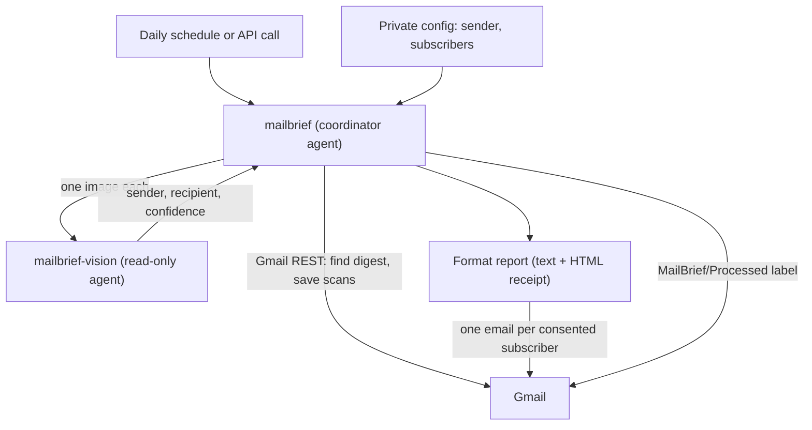

# MailBrief

**MailBrief** reads the daily USPS Informed Delivery email, looks at each
envelope scan, and emails a short report of who is sending mail to whom. It
runs on [Claude Managed Agents](https://platform.claude.com/docs/en/managed-agents/overview)
and is defined entirely in Markdown and YAML: no application code.

USPS Informed Delivery previews show envelope exteriors, **not letter
contents**. They are previews of expected mail, not proof of delivery.

## How it works

- **Two agents.** The coordinator handles Gmail and delivery. The vision
  agent only reads image files; it has no shell, no network and no way to
  send anything, so text on an envelope cannot steer a send.
- **Dedup by label.** A processed digest gets the `MailBrief/Processed` Gmail
  label and is skipped afterwards.
- **Private data stays private.** Subscribers and the sender live in a config
  file kept in GitHub secrets and a private store; credentials live in a
  vault. Neither is in this repository.

## Files

- [agents/mailbrief.md](agents/mailbrief.md), [agents/mailbrief-vision.md](agents/mailbrief-vision.md): the agents (YAML frontmatter is the config, the body is the system prompt).
- [skills/](skills): `mailbrief-gmail`, `mailbrief-vision`, `mailbrief-digest-formatter`, `mailbrief-notification-delivery`, each a directory with a `SKILL.md` ([agentskills.io](https://agentskills.io) layout).
- [deployments/daily-digest.md](deployments/daily-digest.md): the schedule and the message that starts each run.
- [environments/](environments), [vaults/](vaults), [memory_stores/](memory_stores): sandbox, credential container and config store.
- [config/mailbrief.example.yaml](config/mailbrief.example.yaml): config schema with **fictional** values.
- [.github/workflows/](.github/workflows): deploy on merge, and run on demand.

## Getting started

1. Follow [docs/setup.md](docs/setup.md) for the Anthropic, Google and GitHub prerequisites.
2. Merge to `main`; the deploy workflow creates or updates everything.
3. Run a dry run for a past date ([docs/api.md](docs/api.md)) and check the result against the real envelopes ([docs/testing.md](docs/testing.md)).
4. Set `dry_run: false` in the private config once the dry run is right.

## Public repository security

No addresses, real subscriber lists, scan images, account identifiers, tokens
or real mail content belong in this repository. `.env` and `private/` are
git-ignored for local work.

## License

No license is granted by default; add a LICENSE file if you want to permit reuse.
