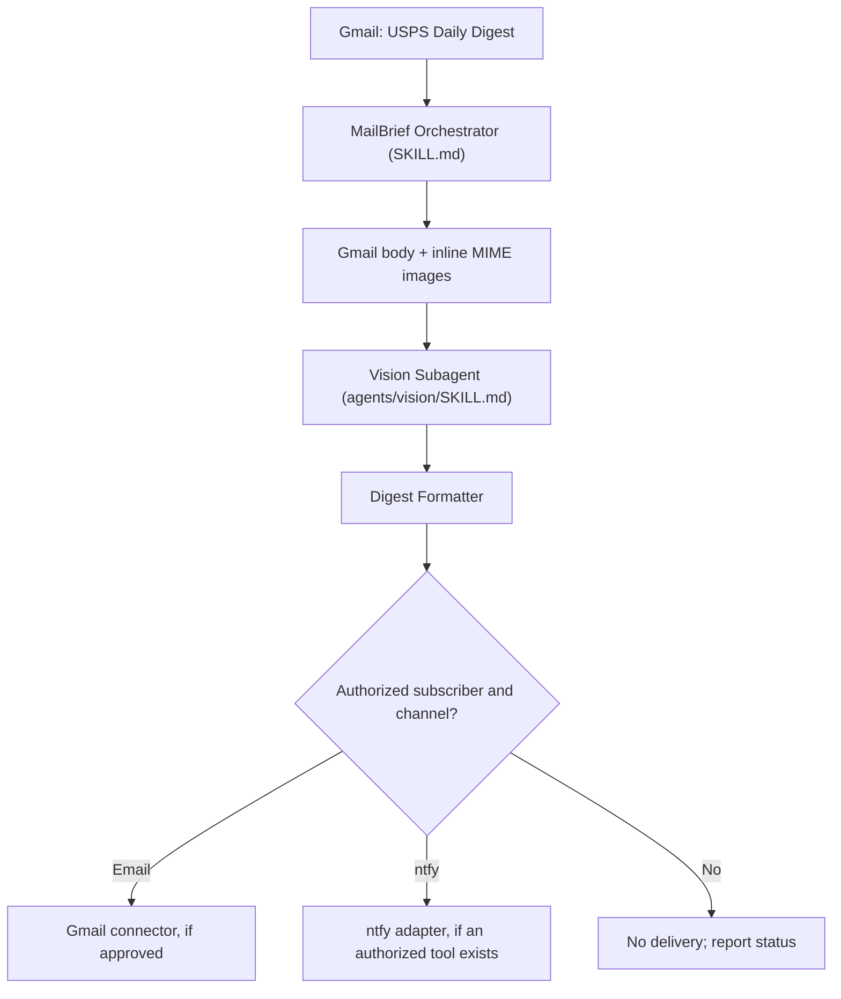

# MailBrief

**MailBrief** is a Markdown-first, OpenAI-managed agent design for summarizing USPS Informed Delivery mail and distributing concise reports to authorized subscribers.

> Status: **architecture and skills prototype**. An end-to-end Gmail event trigger, image access, persistent deduplication, and unattended ntfy delivery have **not yet been validated**. This repository contains no executable background service.

## What it does

1. React to an eligible USPS Informed Delivery Gmail message.
2. Read USPS-reported mailpiece and package counts.
3. Inspect envelope scans, including **inline MIME JPEG images** (not only traditional attachments).
4. Delegate each scan to a vision-analysis skill.
5. Generate a brief, uncertainty-aware report.
6. Apply subscriber privacy policies and deliver only through authorized, available integrations.

USPS Informed Delivery previews generally show envelope exteriors, **not letter contents**. They are previews of anticipated mail, not proof of delivery.

## Architecture

## Files

- [SKILL.md](SKILL.md) — main agent instructions.
- [agents/vision/SKILL.md](agents/vision/SKILL.md) — envelope inspection protocol.
- [skills/digest-formatter/SKILL.md](skills/digest-formatter/SKILL.md) — concise reports.
- [skills/notification-delivery/SKILL.md](skills/notification-delivery/SKILL.md) — explicit delivery and consent requirements.
- [config/subscribers.example.md](config/subscribers.example.md) — **fictional placeholders only**.
- [config/policies.md](config/policies.md) — safety, deduplication and privacy.
- [docs/setup.md](docs/setup.md) — configuration and integration limitations.
- [docs/testing.md](docs/testing.md) — acceptance tests.

## Getting started

1. Connect Gmail in ChatGPT; authorize only the minimum necessary capabilities.
2. In ChatGPT Work, configure a Gmail new-message event filtered to genuine USPS Informed Delivery digest messages **if the trigger is supported in your account**.
3. Attach or supply the Markdown skills to the managed task, according to the supported skill-loading workflow.
4. First test with **read-only** historical USPS messages; verify that inline scans are accessible and correctly classified.
5. Activate email or ntfy delivery **only after** verifying an authorized delivery tool, subscribers' explicit consent, and deduplication.
6. Use a private runtime state store for message IDs, delivery status and subscriber preferences. Do not commit it.

## Public repository security

No addresses, real subscriber lists, scan images, account identifiers, access tokens or real-world mail content belong in this repository. Store secrets in the actual execution environment. **GitHub Actions Secrets are accessible to GitHub Actions, not automatically to ChatGPT Work.** Whether ChatGPT Work exposes a suitable secret or outbound HTTP mechanism must be verified. Never assume Markdown-only instructions grant API or network access.

See [setup instructions](docs/setup.md). No Python runtime or custom server is included.

## License

No license is granted by default; add a LICENSE file if you want to permit reuse under an explicit open-source license.

## Manual invocation, API testing and labels

- Test a date: `Run MailBrief for 2026-11-20; dry run only.`
- Test a range: `Run MailBrief for 2026-11-17 through 2026-11-20 inclusive; dry run only.`
- An authorized Gmail label-by-name action can set `MailBrief/Processed` **without code** after successful analysis.
- Optional Bash + curl example for **eligible Business/Enterprise Workspace Agents API**: [scripts/trigger-workspace-agent.sh](scripts/trigger-workspace-agent.sh). This endpoint is **not confirmed for personal Plus Work tasks**.

Read [manual runs](docs/manual-runs.md) and [single-day image evaluation](docs/vision-evaluation.md).
